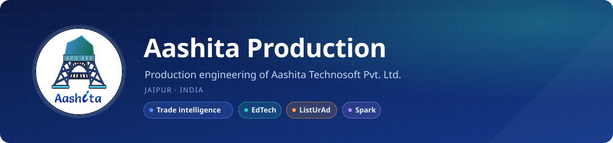
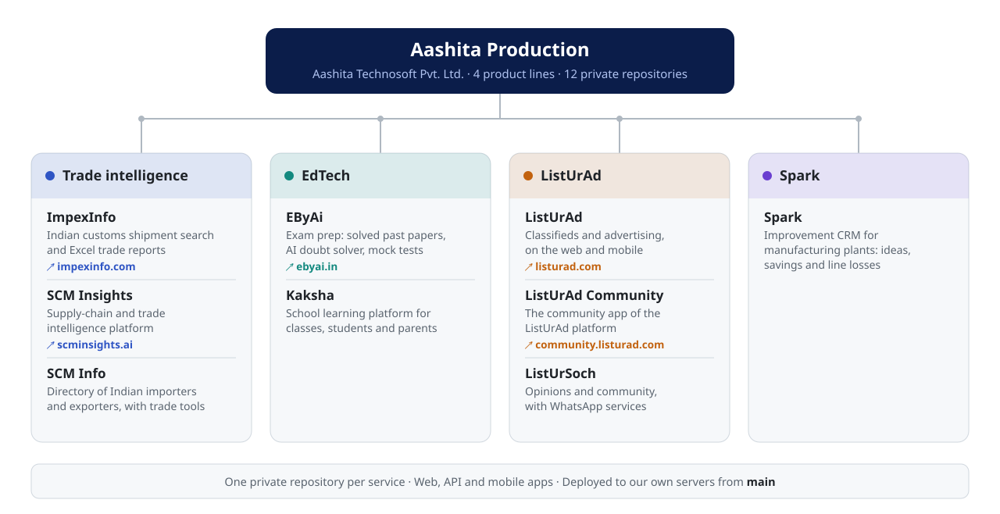

  

  <a href="https://aashitatechnosoft.com"><b>Aashita Technosoft</b></a> &nbsp;·&nbsp;
  <a href="https://aashita.ai"><b>aashita.ai</b></a> &nbsp;·&nbsp;
  <a href="mailto:dev@aashita.ai"><b>dev@aashita.ai</b></a>

This is the production engineering account of **Aashita Technosoft Pvt. Ltd.**, part of the Aashita group in Jaipur, India. It holds the code of the platforms we build and run in production. The repositories are private.

## Platforms

<picture>
  <source media="(prefers-color-scheme: dark)" srcset="assets/platforms-dark.svg">
  
</picture>

  <b>Live:</b> &nbsp;
  <a href="https://www.impexinfo.com">impexinfo.com</a> &nbsp;·&nbsp;
  <a href="https://scminsights.ai">scminsights.ai</a> &nbsp;·&nbsp;
  <a href="https://ebyai.in">ebyai.in</a> &nbsp;·&nbsp;
  <a href="https://listurad.com">listurad.com</a> &nbsp;·&nbsp;
  <a href="https://community.listurad.com">community.listurad.com</a>

## Built with

  

## Working here

- Each service has its own private repository, and `main` is what runs in production.
- Servers pull with read-only deploy keys; nobody's personal key lives on a server.
- Secrets never go into git.

© Aashita Technosoft Pvt. Ltd. · Jaipur, India. The logos in the stack image are trademarks of their owners.
